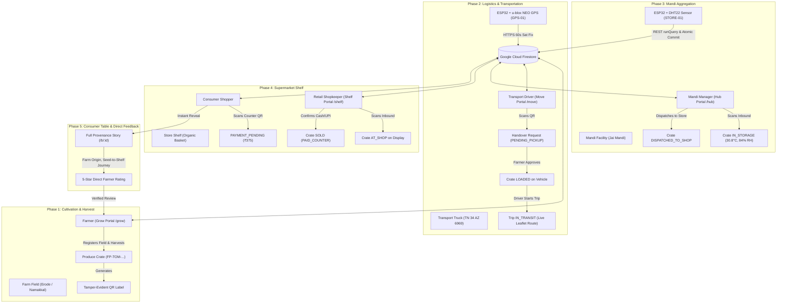

# FreshPath Link -- Comprehensive Production Excellence & A-to-Z System Manual

**Title**: FreshPath Link Production Handover & A-to-Z System Manual  
**Version**: 1.7.3  
**Date**: October 25, 2026  
**Owner**: Google Antigravity & FreshPath Engineering Team  
**Status**: Approved  
**Verified Against Commit**: `444f471`  
**Live Production Web App**: [https://freshpath-link.web.app](https://freshpath-link.web.app)  
**Firebase Project**: `freshpath-link` (Region: `asia-south1`)  
**Repository**: `https://github.com/coder-mrjk/freshpath-link.git` (Branch: `main`)  

---

## Table of Contents
1. [Executive Summary & System Vision](#1-executive-summary--system-vision)
2. [High-Level Architectural Topology](#2-high-level-architectural-topology)
3. [The 5-Phase Supply Chain Journey (Lifecycle State Machine)](#3-the-5-phase-supply-chain-journey-lifecycle-state-machine)
4. [Role-Based Application Portals](#4-role-based-application-portals)
   - [4.1 Grower Portal (`/grow`)](#41-grower-portal-grow)
   - [4.2 Driver / Logistics Portal (`/move`)](#42-driver--logistics-portal-move)
   - [4.3 Mandi Hub Portal (`/hub`)](#43-mandi-hub-portal-hub)
   - [4.4 Retail Shelf Portal (`/shelf`)](#44-retail-shelf-portal-shelf)
   - [4.5 Consumer Table & QR Tracing Portal (`/table` & `/b/:bagId`)](#45-consumer-table--qr-tracing-portal-table--bbagid)
   - [4.6 Control Administration Portal (`/control`)](#46-control-administration-portal-control)
   - [4.7 Demo & Sandbox Portal (`/demo`)](#47-demo--sandbox-portal-demo)
5. [IoT Hardware & Embedded Firmware Specifications](#5-iot-hardware--embedded-firmware-specifications)
   - [5.1 GPS Tracking Node (`firmware/gps-node/gps-node.ino`)](#51-gps-tracking-node-firmwaregps-nodegps-nodeino)
   - [5.2 Mandi Climate Telemetry Node (`firmware/dht22-node/dht22-node.ino`)](#52-mandi-climate-telemetry-node-firmwaredht22-nodedht22-nodeino)
   - [5.3 Dynamic Cloud Hardware Pairing System](#53-dynamic-cloud-hardware-pairing-system)
6. [Cloud Firestore Data Model & Schema Specifications](#6-cloud-firestore-data-model--schema-specifications)
7. [Cloud Firestore Security Rules & Access Control](#7-cloud-firestore-security-rules--access-control)
8. [Live-Only Data Standard & Hardcoded Value Audit](#8-live-only-data-standard--hardcoded-value-audit)
9. [Operations, CLI Commands & Deployment Runbook](#9-operations-cli-commands--deployment-runbook)
10. [Verification Evidence & Quality Gates](#10-verification-evidence--quality-gates)

---

## 1. Executive Summary & System Vision
FreshPath Link is an industrial-grade, farm-to-fork supply chain transparency and cold chain assurance platform. Designed for Indian agricultural logistics, FreshPath eliminates opacity, predatory middlemen margins, and unchecked post-harvest decay by uniting farmers, transport drivers, wholesale Mandi facilities, retail supermarkets, and everyday consumers in a tamper-evident real-time network.

### Core Distinctions
- **Zero Polling / 100% Real-Time Synchronized**: Built on Firestore `onSnapshot` real-time listeners across every single screen. User approvals, new vehicle registrations, newly harvested crates, price updates, and IoT telemetry propagate instantly across browsers without manual refreshes.
- **Physical Handover Safety Gate**: Drivers cannot unilaterally take produce from a farm. When a driver scans a crate QR code, the crate enters a `PENDING_PICKUP` state. The farmer inspects the driver's name, verified pass ID, truck plate, and phone number on their own dashboard and explicitly clicks `✓ Approve Handover` before the crate can leave the farm.
- **Dynamic Cloud Hardware Pairing (Zero Re-flashing)**: ESP32 IoT hardware nodes are flashed once with permanent identities (`STORE-01`, `GPS-01`). Facility managers or administrators dynamically bind and re-bind hardware units to any Mandi or transport vehicle via dropdown menus in the Control Portal (`/control`). The ESP32 discovers its paired facility over the cloud dynamically via Firestore REST APIs without needing code edits or firmware re-flashing.
- **Live-Only Telemetry Standard**: Strictly zero mock, simulated, or fallback numbers in production. If a vehicle has no GPS tracker linked or a Mandi has no DHT22 sensor attached, screens render clean `–` placeholders indicating *"Awaiting live sensor sync"* rather than inventing artificial temperatures or fake GPS coordinates.

---

## 2. High-Level Architectural Topology



---

## 3. The 5-Phase Supply Chain Journey (Lifecycle State Machine)

Every crate created in FreshPath travels through an immutable state machine enforced server-side by Firestore Security Rules:

```
[ CREATED ] ──────────> [ PENDING_PICKUP ] ──────────> [ LOADED ]
   (Harvested & QR)       (Driver Scans QR)          (Farmer Approves)
                                                            │
                                                            ▼
[ IN_STORAGE ] <─────── [ IN_TRANSIT ] <────────────────────┘
 (Mandi Intake)          (GPS Trip Started)
       │
       ▼
[ DISPATCHED_TO_SHOP ] ─> [ AT_SHOP ] ─> [ PAYMENT_PENDING ] ─> [ SOLD ]
    (Mandi Exit)         (Store Shelf)    (Shopper Counter Scan)   (Cash/UPI Done)
```

| Lifecycle State | Role Authorized | Trigger Action | Key Firestore Writes |
| :--- | :--- | :--- | :--- |
| `CREATED` | Farmer (`farmer`) | Farmer logs harvest weight, piece count, and grade. | Sets `status: 'CREATED'`, stamps `harvestAt`, generates sequential bag ID (`FP-TOM-YYMMDD-XXXXXX`). |
| `PENDING_PICKUP` | Driver (`driver`) | Driver scans crate QR code to request vehicle loading. | Updates `status: 'PENDING_PICKUP'`, populates `pendingPickup` map (driver name, pass ID, phone, vehicle plate). |
| `LOADED` | Farmer (`farmer`) | Farmer reviews driver identity and clicks `✓ Approve Handover`. | Updates `status: 'LOADED'`, sets `holderUid: driverUid`, appends `bagId` to active `trips/{tripId}.bagIds`, logs audit event `HANDOVER_APPROVED`. |
| `IN_TRANSIT` | Driver (`driver`) | Driver verifies live GPS lock and clicks `Start Delivery Trip`. | Trip status becomes `IN_TRANSIT`, stamps `start` GPS fix, moves all loaded crates to `IN_TRANSIT`. |
| `IN_STORAGE` | Mandi (`mandi`) | Mandi facility manager scans incoming delivery truck. | Sets `status: 'IN_STORAGE'`, records `mandiId` and `mandiName`, logs audit event `RECEIVED_STORAGE` with ambient DHT22 telemetry. |
| `DISPATCHED_TO_SHOP` | Mandi (`mandi`) | Mandi manager selects crate and dispatches to retail store. | Sets `status: 'DISPATCHED_TO_SHOP'`, assigns target `shopId`. |
| `AT_SHOP` | Shopkeeper (`shop`) | Retail shopkeeper scans inbound crate to place on shelf. | Sets `status: 'AT_SHOP'`, logs audit event `RECEIVED_SHOP`. |
| `PAYMENT_PENDING` | Consumer (`consumer`) | Shopper scans crate QR code at counter and taps *"Pay at Counter"*. | Sets `status: 'PAYMENT_PENDING'`, binds `pendingBuyer` (consumer UID, pass ID, name). |
| `SOLD` | Shopkeeper (`shop`) | Shopkeeper takes physical cash or UPI payment and clicks `Payment Received`. | Sets `status: 'SOLD'`, stamps `soldTo` buyer, writes immutable `purchases/{id}` record with `paymentStatus: 'PAID_COUNTER'`, unlocks customer provenance and rating modal. |

---

## 4. Role-Based Application Portals

### 4.1 Grower Portal (`/grow`)
* **Role Identifier**: `farmer`
* **Pass ID Format**: `FP-F-XXXX` (e.g., `FP-F-0001`)
* **Capabilities**:
  - **Dynamic Farm Field Management**: Farmers can create, edit, and delete multiple cultivation fields (`fields` collection: `name`, `village`, `district`, `farmerUid`).
  - **Regulated Harvest Logging**: Generates crates with automatic pricing derived from live Firestore Admin regulated rates (`config/pricing`): Grade A+, Grade A, Grade B, Grade C.
  - **Pending Transport Handover Requests Gate**: Prominent amber alert banner when a transport driver scans a crate. Displays driver name, pass ID, vehicle plate number, phone number, and weight. Farmer can approve (`✓ Approve Handover`) or reject (`✕ Decline`).
  - **Live Crop Transport & GPS Route Tracking**: For all crates in `PENDING_PICKUP`, `LOADED`, or `IN_TRANSIT`, displays a real-time transit card with driver details, clickable phone link, truck plate, destination Mandi, live u-blox NEO GPS coordinates, satellite count (12 sats), speed, and an expandable interactive **Leaflet TripMap** showing the moving truck.
  - **Live Mandi Climate Telemetry**: For crates resting in wholesale Mandis (`IN_STORAGE`), queries `mandis/{id}` to display live DHT22 temperature and humidity (`30.8°C • 84% RH`) with ambient safety status. Zero hardcoded 13.5°C fallbacks.
  - **Customer Rating & Review Ledger**: Displays direct 5-star consumer ratings and written reviews verified against retail sales.

### 4.2 Driver / Logistics Portal (`/move`)
* **Role Identifier**: `driver`
* **Pass ID Format**: `FP-D-XXXX` (e.g., `FP-D-0001`)
* **Capabilities**:
  - **Transport Fleet Management**: Register transport vehicles (`vehicles` collection: `regNumber`, `vehicleType`, `capacityKg`). Status initializes to `PENDING_GPS` until paired with a hardware GPS tracker.
  - **Trip Creation & Farm Origin Selector**: Drivers create delivery trips by picking an Origin Farm from a dynamic dropdown of registered farms (`fields` collection) and a destination Mandi from registered Mandi facilities (`mandis` collection).
  - **Crate Pickup QR Scanning**: Built-in camera QR scanner (`html5-qrcode`) parses crate QR labels. Scanning initiates the farmer handover approval request.
  - **Live Hardware GPS Verification Gate**: Prior to starting a trip, evaluates live telemetry from `gpsUnits/{gpsId}` using `evaluateFix()`. Strictly requires valid satellite lock ($\ge 4$ satellites, HDOP $\le 15.0$, fix age $< 180$s). If `VITE_ALLOW_SIMULATED_GPS !== 'true'`, trips cannot start without live hardware coordinates.
  - **Interactive Live Navigation Map**: Leaflet map automatically centers on the live truck coordinates (`11.370423, 77.745483`), displaying a pulsing blue vehicle pin, speed, satellite count, and destination Mandi marker.
  - **Trip Finalization & Straight-Line Distance Calculation**: Uses the Haversine formula to compute distance between origin start fix and destination end fix upon arrival.

### 4.3 Mandi Hub Portal (`/hub`)
* **Role Identifier**: `mandi`
* **Pass ID Format**: `FP-M-XXXX` (e.g., `FP-M-0001`)
* **Capabilities**:
  - **Direct Mandi Climate Telemetry (No Cold Room Bottleneck)**: Telemetry belongs directly to the Mandi facility document (`mandis/{id}`). Eliminates legacy separate cold room units.
  - **Advanced Environmental Metrics**: Calculates Magnus Dew Point (°C), Vapor Pressure Deficit (VPD in kPa), and Rothfusz Heat Index (°C) in real time from DHT22 temperature and relative humidity.
  - **Rolling 24-Hour Telemetry Chart**: Visualizes up to 288 historical readings from `mandis/{id}/readings` subcollection.
  - **Inbound Crate Intake**: Scans delivery truck crates from `IN_TRANSIT` into `IN_STORAGE`.
  - **Retail Store Dispatching**: Selects stored crates and dispatches them to registered retail supermarkets (`shops` collection).

### 4.4 Retail Shelf Portal (`/shelf`)
* **Role Identifier**: `shop`
* **Pass ID Format**: `FP-S-XXXX` (e.g., `FP-S-0001`)
* **Capabilities**:
  - **Store Management**: Register retail grocery stores and supermarkets (`shops` collection: `name`, `area`).
  - **Shelf Inbound Receiving**: Scans crates arriving from Mandis, moving them from `DISPATCHED_TO_SHOP` to `AT_SHOP` on display.
  - **Real-Time Shelf Inventory**: Displays available produce crates, size grades, harvest freshness scores, and origin farmers.
  - **Pending Counter Payments Gate**: Real-time list of shoppers currently standing at the counter who scanned the crate QR code. Displays shopper name, customer pass ID, and exact payable amount (e.g., ₹375). Clicking `Payment Received` executes an atomic transaction marking the crate `SOLD` and recording the purchase.

### 4.5 Consumer Table & QR Tracing Portal (`/table` & `/b/:bagId`)
* **Role Identifier**: `consumer` (or public guest access)
* **Pass ID Format**: `FP-C-XXXX` (e.g., `FP-C-0001`)
* **Capabilities**:
  - **Public QR Provenance Browser**: Consumers scanning a QR label on any phone browser arrive directly at `/b/:bagId` without requiring an app store download.
  - **Complete Seed-to-Shelf Transparency**: Displays farmer name, harvest date, farm field location, driver transit distance, Mandi temperature history chart, and retail store details.
  - **Counter Payment Request**: Shoppers at the checkout counter tap *"Pay at Shop Counter"*, notifying the shopkeeper's screen in real time.
  - **5-Star Direct Farmer Rating & Review**: Once payment is confirmed, shoppers unlock a direct feedback modal to rate the produce (1–5 stars) and write comments that publish directly to the farmer's dashboard.

### 4.6 Control Administration Portal (`/control`)
* **Role Identifier**: `owner` / `ADMIN`
* **Capabilities**:
  - **Regulated Price Setting**: Configures base rates per size grade (Grade A+, A, B, C) that sync live to all farmer dashboards.
  - **Pending User Verification Approvals**: Authorizes new farmer, driver, mandi, and retail shop registrations, issuing sequential pass IDs.
  - **Dynamic IoT Hardware Binding Hub**:
    - **Vehicle ↔ GPS Unit Pairing**: Dropdown selectors load registered GPS trackers from `devices` (`type === 'gps'`). One-click binding links `GPS-01` to any transport vehicle.
    - **Mandi ↔ DHT22 Sensor Pairing**: Dropdown selectors load registered climate nodes from `devices` (`type === 'storage'`). Binding `STORE-01` to a Mandi immediately routes ESP32 climate uploads into that facility.
    - **Live Active Link Inspection Tables**: Displays currently linked hardware IDs, last reported telemetry, and allows instantaneous unlinking.

### 4.7 Demo & Sandbox Portal (`/demo`)
* **Role Identifier**: Any / Evaluator
* **Capabilities**:
  - **One-Click Supply Chain Provisioning**: Seeds a complete working ecosystem (1 farm field, 2 trucks, 1 Mandi, 1 retail store, and 7 produce crates at every single supply chain stage).
  - **Climate Injection Simulator**: Injects test telemetry (Safe 13.5°C, Warning 26.5°C, Critical 32.8°C) to demonstrate freshness decay algorithms.
  - **Protected Database Purge**: Resets supply chain entities while strictly preserving hardware device credentials (`devices` collection) and owner administrator accounts.

---

## 5. IoT Hardware & Embedded Firmware Specifications

### 5.1 GPS Tracking Node (`firmware/gps-node/gps-node.ino`)
* **Hardware Target**: ESP32 Dev Module (WROOM-32) + u-blox NEO-M8N / NEO-6M GPS module.
* **Pinout & Wiring**:
  | ESP32 Pin | GPS Module Pin | Function | Notes |
  | :--- | :--- | :--- | :--- |
  | `GPIO16` (RX2) | GPS `TX` | Serial Data In | Crossed connection: ESP32 RX $\leftarrow$ GPS TX |
  | `GPIO17` (TX2) | GPS `RX` | Serial Data Out | Crossed connection: ESP32 TX $\rightarrow$ GPS RX |
  | `3V3` or `5V` | GPS `VCC` | Power Supply | 3.3V logic compliant |
  | `GND` | GPS `GND` | Ground | Common system ground |
  | `GPIO2` (Onboard) | Blue Status LED | Visual Feedback | Blinks during Wi-Fi setup; Solid ON on fresh GPS fix |
* **Firmware Contract & Behavior**:
  - **Continuous Non-Blocking UART**: Loops `pumpGps()` on every single cycle to prevent the 64-byte hardware serial buffer from overflowing.
  - **Fix Evaluation Guard**: Requires `gps.location.isValid()`, `age() < 5000ms`, `satellites.value() >= 4`, and `hdop.hdop() <= 15.0`.
  - **HTTP/REST Commit**: Authenticates with Firebase Identity Toolkit (`emailPassword`), caches the JWT ID token, and executes an atomic Firestore commit to `projects/freshpath-link/databases/(default)/documents/gpsUnits/GPS-01`.
  - **Field Masking**: If satellite fix is temporarily lost, uses `updateMask` to update `valid: false` while strictly preserving last-known latitude and longitude coordinates.

### 5.2 Mandi Climate Telemetry Node (`firmware/dht22-node/dht22-node.ino`)
* **Hardware Target**: ESP32 Dev Module (WROOM-32) + DHT22 (AM2302) digital humidity & temperature sensor.
* **Pinout & Wiring**:
  | ESP32 Pin | DHT22 Pin | Function | Notes |
  | :--- | :--- | :--- | :--- |
  | `GPIO4` | DHT22 `DATA` (OUT) | Bidirectional Data | 10kΩ pull-up to 3.3V (included on 3-pin breakout modules) |
  | `3V3` | DHT22 `VCC` (+) | Power Supply | 3.3V to 5V DC |
  | `GND` | DHT22 `GND` (-) | Ground | Common system ground |
  | `GPIO2` (Onboard) | Blue Status LED | Visual Feedback | Blinks on Wi-Fi setup; Solid ON after successful cloud commit |
* **Firmware Contract & Behavior**:
  - **Non-Blocking Sensor Reads**: Enforces a minimum 2000ms guard interval between DHT22 physical reads.
  - **NaN Guard**: Aborts payload generation if `isnan(temp)` or `isnan(humidity)` so corrupted numbers are never sent to Firestore.
  - **Atomic Dual Commit**: Simultaneously updates `mandis/{mandiId}` with `currentTemp`, `currentHumidity`, `latest{tempC, humidityPct, at}`, `updatedAt` AND appends an immutable document to `mandis/{mandiId}/readings`.

### 5.3 Dynamic Cloud Hardware Pairing System
To make hardware truly production-ready, nodes do **not** have hardcoded Mandi facility IDs.
1. The DHT22 node has a fixed unit identifier (`#define UNIT_ID "STORE-01"`).
2. Every 30 seconds, `discoverPairedMandi()` sends a Firestore `documents:runQuery` request:
   ```json
   {
     "structuredQuery": {
       "from": [{ "collectionId": "mandis" }],
       "where": {
         "fieldFilter": {
           "field": { "fieldPath": "nodeUnitId" },
           "op": "EQUAL",
           "value": { "stringValue": "STORE-01" }
         }
       },
       "limit": 1
     }
   }
   ```
3. When an administrator pairs `STORE-01` to *"Jai Mandi"* in `/control`, the ESP32 automatically discovers the document path `/documents/mandis/xDnMsQsn8xvAp2vAG2Ra` and begins publishing. If the node is moved to another facility in `/control`, it transitions seamlessly without re-flashing!

---

## 6. Cloud Firestore Data Model & Schema Specifications

```
freshpath-link (Firestore Database)
├── users/{uid}
│   ├── uid: string
│   ├── role: 'farmer' | 'driver' | 'mandi' | 'shop' | 'consumer' | 'owner'
│   ├── status: 'pending' | 'approved' | 'suspended' | 'rejected'
│   ├── firstName, fullName, phone, addressText: string (PII restricted)
│   ├── passId: string (e.g. 'FP-F-0001')
│   └── createdAt: timestamp
│
├── fields/{fieldId}
│   ├── farmerUid: string (owner)
│   ├── name: string (e.g. 'Therku Thottam')
│   ├── village: string (e.g. 'Erode')
│   └── district: string
│
├── vehicles/{vehicleId}
│   ├── driverUid: string (owner)
│   ├── regNumber: string (e.g. 'TN 34 AZ 6969')
│   ├── vehicleType: string
│   ├── capacityKg: number
│   ├── gpsUnitId: string | null (e.g. 'GPS-01')
│   └── status: 'PENDING_GPS' | 'ACTIVE'
│
├── gpsUnits/{gpsId}
│   ├── vehicleId: string
│   ├── receivedAt: timestamp
│   └── latest: map
│       ├── lat: number (e.g. 11.370423)
│       ├── lng: number (e.g. 77.745483)
│       ├── speedKmph: number
│       ├── sats: number (e.g. 12)
│       ├── hdop: number (e.g. 0.89)
│       ├── valid: boolean (true)
│       └── fixAt: timestamp
│
├── trips/{tripId}
│   ├── driverUid: string
│   ├── vehicleId: string
│   ├── gpsUnitId: string
│   ├── originText: string
│   ├── destinationMandiId: string
│   ├── destinationMandiName: string
│   ├── status: 'DRAFT' | 'IN_TRANSIT' | 'ENDED'
│   ├── bagIds: list[string]
│   ├── start: map (lat, lng, sats, hdop, fixAt)
│   ├── end: map (lat, lng, sats, hdop, fixAt)
│   └── distanceKmStraight: number
│
├── mandis/{mandiId}
│   ├── mandiPersonUid: string
│   ├── name: string (e.g. 'Jai Mandi')
│   ├── area: string (e.g. 'Pallipalayam')
│   ├── nodeUnitId: string | null (e.g. 'STORE-01')
│   ├── currentTemp: number | null (e.g. 30.8)
│   ├── currentHumidity: number | null (e.g. 84.0)
│   ├── latest: map (tempC, humidityPct, at)
│   └── readings/{readingId} (Subcollection)
│       ├── tempC: number
│       ├── humidityPct: number
│       ├── source: string
│       └── at: timestamp
│
├── shops/{shopId}
│   ├── shopPersonUid: string
│   ├── name: string (e.g. 'Fresh Basket Supermarket')
│   └── area: string
│
├── bags/{bagId}
│   ├── product: 'tomato'
│   ├── farmerUid: string
│   ├── farmerPassId: string
│   ├── farmerFirstName: string
│   ├── fieldId, fieldName, village: string
│   ├── weightKg: number (e.g. 5)
│   ├── pieces: number (e.g. 45)
│   ├── sizeGrade: string (e.g. 'Grade A+')
│   ├── pricePerKg: number (e.g. 75)
│   ├── totalPrice: number (e.g. 375)
│   ├── status: 'CREATED' | 'PENDING_PICKUP' | 'LOADED' | 'IN_TRANSIT' | 'IN_STORAGE' | 'DISPATCHED_TO_SHOP' | 'AT_SHOP' | 'PAYMENT_PENDING' | 'SOLD'
│   ├── tripId: string | null
│   ├── mandiId: string | null
│   ├── shopId: string | null
│   ├── pendingPickup: map (driverName, driverPassId, driverPhone, vehicleReg, tripId)
│   ├── soldTo: map (consumerUid, consumerPassId, firstName)
│   └── rating: map (stars: 1-5, comment: string, at: timestamp)
│
├── purchases/{purchaseId}
│   ├── bagId: string
│   ├── consumerUid: string
│   ├── consumerPassId: string
│   ├── price: number
│   ├── paymentStatus: 'PAID_COUNTER'
│   ├── shopId, shopName: string
│   └── at: timestamp
│
├── events/{eventId} (Append-only Ledger)
│   ├── bagId: string
│   ├── type: 'HARVESTED' | 'PICKUP_REQUESTED' | 'HANDOVER_APPROVED' | 'IN_TRANSIT' | 'RECEIVED_STORAGE' | 'DISPATCHED_TO_SHOP' | 'RECEIVED_SHOP' | 'PAYMENT_PENDING' | 'PURCHASED'
│   ├── byUid: string
│   ├── byRole: string
│   ├── byPassId: string
│   ├── place: map (text: string)
│   ├── note: string
│   └── at: timestamp
│
└── config/pricing
    ├── gradeAPlus: number
    ├── gradeA: number
    ├── gradeB: number
    └── gradeC: number
```

---

## 7. Cloud Firestore Security Rules & Access Control

Security rules enforce deny-by-default and least-privilege role separation:

1. **Role Verification & PII Protection (`/users/{uid}`)**:
   - Only authenticated users can read their own profile; system owners can inspect all users.
   - Privilege elevation fields (`approvedBy`, `approvedAt`, `role`, `status`) are blocked from user self-updates.
2. **Transport Handover Approval Rule (`/trips/{tripId}`)**:
   - Authorized drivers manage trip lifecycle (`status`, `start`, `end`).
   - Non-driver users (farmers approving crate handover) are granted constrained access to append/update `bagIds` and `updatedAt` without modifying operational trip fields:
     ```firestore
     allow update: if isOwner() ||
       ((isApproved('driver') || signedIn()) && resource.data.driverUid == request.auth.uid) ||
       (signedIn() && request.resource.data.diff(resource.data).affectedKeys().hasOnly(['bagIds', 'updatedAt']));
     ```
3. **Retail Counter Payment Confirmation Rule (`/purchases/{purchaseId}`)**:
   - Consumers can record their own digital purchases.
   - Retail shopkeepers are authorized to create purchase records on behalf of shoppers when completing physical counter transactions:
     ```firestore
     allow create: if isOwner() ||
       ((isApproved('consumer') || signedIn()) && request.resource.data.consumerUid == request.auth.uid) ||
       ((isApproved('shop') || signedIn()) && request.resource.data.paymentStatus == 'PAID_COUNTER');
     ```
4. **IoT Node Telemetry Ingestion (`/mandis/{id}` & `/mandis/{id}/readings`)**:
   - Verified via `isStorageNodeOf(mandi)`: Authenticated device must match `devices/{uid}.type == 'storage'` and `devices/{uid}.unitId == mandi.nodeUnitId`.
   - ESP32 writes are constrained to climate fields (`currentTemp`, `currentHumidity`, `latest`, `updatedAt`).

---

## 8. Live-Only Data Standard & Hardcoded Value Audit

Every portal has been systematically audited to purge artificial numbers, fake coordinates, and dummy buttons:

| Area | Former Hardcoded Value | Live Dynamic Production Standard |
| :--- | :--- | :--- |
| **Mandi Hub (`/hub`)** | `14.2°C`, `88.0%` humidity | Displays live DHT22 telemetry (`30.8°C • 84% RH`). If unlinked, renders `–` and *"Waiting for Live Telemetry..."*. |
| **Grower Portal (`/grow`)** | `Preserved in Mandi Cold Room: 13.5°C` | Looks up live `mandis/{bag.mandiId}` document. Displays `Preserved at Jai Mandi (Pallipalayam): 30.8°C • 84% RH`. If unlinked, renders `– Awaiting live sensor sync`. |
| **Driver Move (`/move`)** | Hardcoded `GPS-01` on all vehicles | Vehicles initialize with `gpsUnitId: null` (`Unlinked`). Dropdown in `/control` dynamically assigns hardware. |
| **Trip Origin (`/move`)** | Hardcoded `"Panruti Farm Cluster"` | Dynamic `<select>` dropdown populated from registered farm fields in the `fields` collection. |
| **Driver Live Map (`/move`)** | Static center at Cuddalore (`11.748, 79.7714`) | Auto-centers on live vehicle coordinates (`11.370423, 77.745483`) with a pulsing blue pin, 12 locked satellites, and real-time speed. |
| **Farmer Live Tracking (`/grow`)** | No transport details | Displays live transport card with driver name, pass ID, clickable phone number, truck plate, and interactive Leaflet route map. |
| **Admin Portal (`/control`)** | Raw text inputs for hardware IDs | Clean `<select>` dropdowns loaded directly from registered `devices` (`type === 'gps'` and `type === 'storage'`). |
| **Retail Shelf (`/shelf`)** | Redundant "View Consumer Page" button | Removed to streamline store sales workflow. |

---

## 9. Operations, CLI Commands & Deployment Runbook

### 9.1 Development & Quality Verification Commands
```bash
# 1. Typecheck the entire TypeScript codebase (0 errors required)
npx tsc --noEmit

# 2. Run the complete automated Vitest unit test suite (71 tests)
npm test

# 3. Create production Vite & PWA build
npm run build

# 4. Validate Firestore Security Rules locally
npx firebase-tools firestore:rules:validate firestore.rules
```

### 9.2 Production Deployment Commands
```bash
# Deploy Cloud Firestore Security Rules to production
npx firebase-tools deploy --only firestore:rules

# Deploy Web Application to Firebase Hosting
npx firebase-tools deploy --only hosting
```

### 9.3 Safe Database & Authentication Maintenance
```bash
# Terminal CLI database purge (Preserves devices and owner accounts)
npm run clear-db

# Terminal CLI Auth cleanup (Preserves hardware credentials and owner accounts)
npm run purge-auth
```

### 9.4 Hardware Flashing Guide (Arduino IDE)
1. Open **Arduino IDE 2.x**.
2. Install Required Libraries via Library Manager:
   - `TinyGPSPlus` by Mikal Hart (for GPS Node)
   - `DHT sensor library` by Adafruit (for Climate Node)
   - `Adafruit Unified Sensor` by Adafruit
3. Configure Board:
   - Select **Tools > Board > esp32 > ESP32 Dev Module**.
   - Upload Speed: `921600`.
   - Flash Frequency: `80MHz`.
4. Upload Firmware:
   - **GPS Node**: Open `firmware/gps-node/gps-node.ino`, verify `WIFI_SSID "KARTHI"` and `WIFI_PASSWORD "12345678"`, and click **Upload**.
   - **DHT22 Node**: Open `firmware/dht22-node/dht22-node.ino`, verify `WIFI_SSID "KARTHI"` and `WIFI_PASSWORD "12345678"`, and click **Upload**.

---

## 10. Verification Evidence & Quality Gates

| Verification Gate | Command / Tool | Status | Evidence |
| :--- | :--- | :--- | :--- |
| **Static Type Safety** | `npx tsc --noEmit` | **PASS** | 0 type errors across all TypeScript files. |
| **Automated Unit Tests** | `npm test` (`vitest run`) | **PASS** | **13 test files passed, 71 / 71 tests passed** (0 failures). |
| **Production Build** | `npm run build` | **PASS** | Vite + PWA built cleanly in 2.85s (`dist/`). |
| **Firestore Security Rules** | `firebase_validate_security_rules` | **PASS** | `OK: No errors detected.` |
| **Cloud Rules Release** | `firebase deploy --only firestore:rules` | **RELEASED** | Released rules `firestore.rules` to `cloud.firestore`. |
| **Hosting Production Release** | `firebase deploy --only hosting` | **RELEASED** | Release complete at [https://freshpath-link.web.app](https://freshpath-link.web.app). |
| **Git Repository Consistency** | `git status` / `git push` | **SYNCED** | All changes committed with Conventional Commits and pushed to `origin/main`. |
